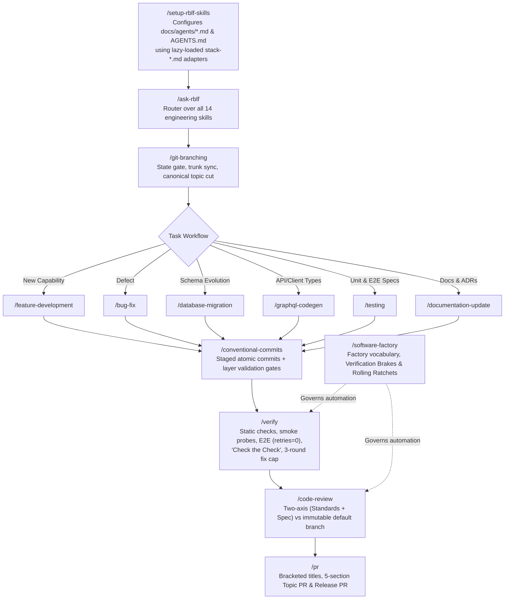

# ricardobizerra/skills

Disciplined engineering, repository governance, and verification skills for AI coding agents — built under [`SKILL.md`](https://skills.sh) conventions and inspired by [`mattpocock/skills`](https://github.com/mattpocock/skills).

Instead of black-box frameworks that strip away developer control or loose "vibe coding" that corrupts git history and weakens tests, these skills are **small, composable, human-editable Markdown playbooks** that enforce production engineering invariants: verified trunk branching, staged atomic commits, zero-flakiness verification gates, immutable default-branch code review, and evidence-backed pull requests.

---

## Quickstart & Installation

### 1. Editable Install via `skills.sh` (`npx skills`)

Install the full suite or pick individual skills directly into your repository's `.agents/skills/` (or `.claude/skills/`):

```bash
# Install all skills from ricardobizerra/skills
npx skills@latest add ricardobizerra/skills

# Install a single skill (e.g., setup-rblf-skills or git-branching)
npx skills@latest add ricardobizerra/skills --skill=setup-rblf-skills
npx skills@latest add ricardobizerra/skills --skill=git-branching

# Keep installed skills updated
npx skills@latest update
```

### 2. Plugin Marketplaces (Claude Code, Codex, GitHub Copilot)

This repository includes [`.claude-plugin/marketplace.json`](.claude-plugin/marketplace.json) for native plugin installation:

```bash
# Claude Code
claude plugin marketplace add ricardobizerra/skills
claude plugin install rblf-skills@ricardobizerra

# Codex
codex plugin marketplace add ricardobizerra/skills
codex plugin add rblf-skills@ricardobizerra

# GitHub Copilot
copilot plugin marketplace add ricardobizerra/skills
copilot plugin install rblf-skills@ricardobizerra
```

---

## The Engineering Flow

Run [`/setup-rblf-skills`](skills/engineering/setup-rblf-skills/SKILL.md) once in a target repository to scaffold `docs/agents/*.md` and wire up `AGENTS.md` / `CLAUDE.md`. If you aren't sure which skill fits your current task, ask [`/ask-rblf`](skills/engineering/ask-rblf/SKILL.md).



---

## Skills Catalog (`skills/engineering/`)

### Meta, Onboarding & Architecture
| Skill | Description |
| :--- | :--- |
| [`/ask-rblf`](skills/engineering/ask-rblf/SKILL.md) | Meta-router over all 14 skills in this repository. Explains which skill or sequence fits your current engineering bottleneck. |
| [`/setup-rblf-skills`](skills/engineering/setup-rblf-skills/SKILL.md) | One-time per-repo onboarding: discovers your stack via lazy-loaded adapters (`stack-docker-fullstack.md`, `stack-node-ts.md`, `stack-python.md`, `stack-generic.md`) and scaffolds `docs/agents/*.md` + `AGENTS.md`. |
| [`/software-factory`](skills/engineering/software-factory/SKILL.md) | Shared language and architecture for designing an autonomous software factory: tasks, triggers, runs, runners, **Verification Brakes** (immutable default-branch standards, protected paths), and **Rolling Ratchets**. |

### Core Governance & Verification Spine
| Skill | Description |
| :--- | :--- |
| [`/git-branching`](skills/engineering/git-branching/SKILL.md) | Pre-flight repository state gate, clean tree classification, local trunk synchronization (`--ff-only`), canonical topic branch cutting (`feature/`, `fix/`, `chore/`, `refactor/`, `docs/`, `test/`, `perf/`), drift detection, `--no-rebase` trunk sync, and `develop` / trunk promotion. |
| [`/conventional-commits`](skills/engineering/conventional-commits/SKILL.md) | Conventional Commits v1.0.0 formatting, hierarchical scoping, and an adaptive N-stage atomic commit pipeline that orders backend, codegen, frontend, and documentation commits behind per-layer validation gates. |
| [`/verify`](skills/engineering/verify/SKILL.md) | End-to-end evidence-based verification: static gates, unit/integration suites, stack readiness smoke probes ([`verify-smoke.mjs`](skills/engineering/verify/scripts/verify-smoke.mjs)), zero-retry E2E (`retries: 0`, no skips/sleeps), "Check the Check", cold `/code-review`, and a 3-round fix cap. |
| [`/code-review`](skills/engineering/code-review/SKILL.md) | Parallel two-axis diff review (**Standards** vs. **Spec**) enforcing **Default-Branch Review Immutability** (`origin/main:REVIEW.md`), **Protected Verification Paths** auditing, and the 12 Fowler code smells baseline. |
| [`/pr`](skills/engineering/pr/SKILL.md) | Canonical bracketed PR titles (`[Feature]`, `[Fix]`, `[Release]`, etc.), 5-section Topic PR body (`Summary` visuals, before/after `Evidence`, `Merge Danger` door/blast-radius, executed `Verification Gates`, `References`), and Release PR template. |

### Task & Layer Workflows
| Skill | Description |
| :--- | :--- |
| [`/testing`](skills/engineering/testing/SKILL.md) | Unit, integration, and browser E2E testing discipline: zero flakiness workarounds (`retries: 0`, no `.skip` or `sleep`), "Check the Check" failure proof, container-relative path execution, and 3-round fix cap. |
| [`/bug-fix`](skills/engineering/bug-fix/SKILL.md) | Surgical defect resolution: pre-flight `fix/<topic>` branch gate, tight feedback loop with a failing reproduction spec first, minimal root-cause fix, artifact/doc sync, and full verification. |
| [`/feature-development`](skills/engineering/feature-development/SKILL.md) | Full-stack capability delivery coordinated across schema, backend domain, codegen, frontend UI, tests, docs/ADRs, and the staged atomic commit pipeline. |
| [`/database-migration`](skills/engineering/database-migration/SKILL.md) | Safe database schema evolution (Prisma, Drizzle, Alembic, TypeORM, Django, raw SQL): domain glossary alignment, expand-and-contract safety, mandatory generated SQL inspection, artifact sync, and rollback discipline. |
| [`/graphql-codegen`](skills/engineering/graphql-codegen/SKILL.md) | Dual-stage synchronization between backend GraphQL schemas (`schema.gql` / `schema.graphql`) and typed frontend client artifacts (GraphQL Code Generator, Apollo, Relay, `gql.tada`). |
| [`/documentation-update`](skills/engineering/documentation-update/SKILL.md) | Progressive disclosure for `AGENTS.md` / `CLAUDE.md`, pure domain modeling in `GLOSSARY.md`, high-bar ADR recording in `docs/adr/`, index synchronization, and link/command consistency checks. |

---

## Repository Domain Docs

- [**GLOSSARY.md**](GLOSSARY.md) — Canonical vocabulary of this skills repository.
- [**Architectural Decision Records (`docs/adr/`)**](docs/adr/):
  - [ADR 0001: Per-Repo Setup Contract and Lazy Stack Adapters](docs/adr/0001-setup-contract-and-lazy-stack-adapters.md)
  - [ADR 0002: Immutable Verification Brakes and Protected Verification Paths](docs/adr/0002-immutable-verification-brakes-and-protected-paths.md)
  - [ADR 0003: Upstream Skill Attribution and Governance Specialization](docs/adr/0003-upstream-skill-attribution-and-specialization.md)
  - [ADR 0004: Curated Maintainer Governance and Out-of-Scope Ledger](docs/adr/0004-curated-maintainer-governance-and-out-of-scope-ledger.md)
  - [ADR 0005: Zero-Dependency Repo Validation and Self-Hosted Dogfooding](docs/adr/0005-zero-dependency-repo-validation-and-self-hosted-dogfooding.md)

---

## Governance & Contributing

- [**CONTRIBUTING.md**](CONTRIBUTING.md) — **Curated Maintainer Model** (issues welcome; direct PRs restricted to maintainers/collaborators) and local validation instructions.
- [**SCOPE.md**](SCOPE.md) & [**.out-of-scope/**](.out-of-scope/) — **Observed-Failure Bar** and standing scope rejection ledger.
- [**REVIEW.md**](REVIEW.md) — Immutable code-review policy evaluated from `origin/main`.
- [**CHANGELOG.md**](CHANGELOG.md) — Release history (Keep a Changelog / SemVer via `.claude-plugin/marketplace.json`).
- [**SECURITY.md**](SECURITY.md) — Private vulnerability reporting policy.
- [**LICENSE**](LICENSE) — MIT License.

---

## Credits & Attribution

- Inspired by [**Matt Pocock**](https://github.com/mattpocock)'s [`mattpocock/skills`](https://github.com/mattpocock/skills). Specifically, [`code-review`](skills/engineering/code-review/CREDITS.md), [`pr`](skills/engineering/pr/CREDITS.md), and [`software-factory`](skills/engineering/software-factory/CREDITS.md) adapt and extend upstream concepts with repository governance, verification brakes, and release workflows.
- The visual summary menu in [`pr`](skills/engineering/pr/CREDITS.md) credits [**Dex Horthy**](https://github.com/dexhorthy)'s [`show-me`](https://github.com/humanlayer/skills/blob/main/plugins/show-me/skills/show-me/SKILL.md) skill from Humanlayer.
