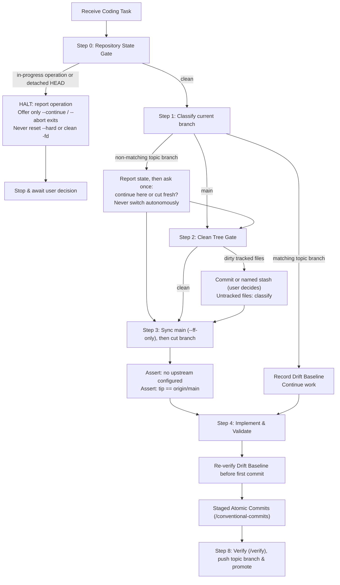

# Git Branching Strategy & Lifecycle Workflow

## Purpose

Enforce disciplined, trunk-based branch management across any software repository. All coding tasks execute on short-lived, **Canonical Topic Branches** cut from a **verified-synchronized local trunk (`main`)**, push to `origin/<prefix>/<slug>` once validated, and promote either into an intermediate **`develop`** integration branch (two-branch topology) or directly via pull request to **`main`** (single-trunk topology).

### Configuration Discovery (`docs/agents/git-workflow.md`)

1. If `docs/agents/git-workflow.md` exists (created by [`/setup-rblf-skills`](../setup-rblf-skills/SKILL.md)), read it for:
   - The **trunk branch name** (defaults to `main`, or `master` in legacy repos).
   - The **promotion topology**: **two-branch (`main` + `develop`)** vs. **single-trunk (`main` only)**.
   - Any optional repo-specific branch audit script (e.g., `bun run git:check` or `npm run git:check`).
2. If `docs/agents/git-workflow.md` does not exist yet, auto-detect by running `git branch -a`:
   - If `origin/develop` or local `develop` exists, use the **two-branch (`main` + `develop`)** topology.
   - Otherwise, use the **single-trunk (`main` only)** topology.

---

## The Golden Rules

1. **Never edit, commit, or push directly on `main`** — with exactly one named exception: the emergency production hotfix cherry-pick in Step 7. Direct commits on `main` bypass review and CI, and pollute the local base that future topic branches cut from.
2. **Synchronize local `main`, then branch from it.** Never cut a topic branch directly from `origin/main` or `develop` (unless explicitly instructed by the user). Running `git checkout -b <slug> origin/main` auto-configures the new branch's upstream to `origin/main`, turning a later `git push` into an accidental push to trunk. Always run `git fetch origin main` + `git merge --ff-only origin/main` on local `main` first, then branch from local `main` (Step 3).
3. **A topic branch must never track the trunk or `develop`.** Immediately after creating a branch, assert that `<branch>@{upstream}` does not resolve.
4. **Clean tree gate**: never switch branches with uncommitted *tracked* modifications. Untracked files are classified separately, not automatically blocked, and never deleted with `git clean -fd` (Step 2).
5. **Sync from `main` via pull, never rebase or force-push**: bring upstream `main` advances onto a topic branch via `git pull --no-rebase origin main` (Step 5). Because topic branches are pushed to `origin`, rebasing rewrites remote history and requires force-pushing (`--force`, `--force-with-lease`), which is forbidden across all branches. In two-branch repos, never merge `develop` into a topic branch.
6. **Promotion requires confirmation**:
   - In **two-branch (`main` + `develop`)** repos: mature topic branches merge into `develop` via `git merge --no-ff <branch>` and push to `origin/develop` **only** after explicit user confirmation (Step 6). Do not emit PR title/body boilerplate on routine topic completion; generate PR details only on-demand (e.g., Release PR `develop` → `main`, urgent bypass PR, or `/pr`).
   - In **single-trunk (`main` only)** repos: push the validated topic branch (`git push -u origin <prefix>/<slug>`) and ask the user whether to open/format a Pull Request targeting `main` via [`/pr`](../pr/SKILL.md).

---

## Execution Workflow



---

## Step 0: Repository State Gate (Mandatory, Before Any File Edit)

An unfinished git operation is not "a dirty tree"—it is an active state machine with its own recovery semantics. Running `git reset --hard` or `git clean -fd` during an in-progress operation destroys rebase/merge state and untracked work irrecoverably.

### Step 0.1: Detect In-Progress Operations

```bash
git rev-parse --abbrev-ref HEAD   # empty output or "HEAD" means detached HEAD
git status                        # first lines name any active operation
ls .git | grep -E '^(rebase-merge|rebase-apply|MERGE_HEAD|CHERRY_PICK_HEAD|REVERT_HEAD|BISECT_LOG)$'
```

| Signal | Meaning |
| :--- | :--- |
| empty `git rev-parse --abbrev-ref HEAD` or `HEAD` | Detached HEAD |
| `.git/rebase-merge/` or `.git/rebase-apply/` | Rebase in progress (interactive rebase reports `"interactive rebase in progress"`) |
| `.git/MERGE_HEAD` | Merge in progress |
| `.git/CHERRY_PICK_HEAD` | Cherry-pick in progress |
| `.git/REVERT_HEAD` | Revert in progress |
| `.git/BISECT_LOG` | Bisect in progress |

### Step 0.2: Halt With a Non-Destructive State-Read Menu

If any signal is present, **stop immediately**. Report the operation type and any conflicted/affected files, then present **only** non-destructive exits:

| Operation | Offer Only |
| :--- | :--- |
| Rebase | `git rebase --continue`, `git rebase --skip`, `git rebase --abort` |
| Merge | `git merge --continue`, `git merge --abort` |
| Cherry-pick | `git cherry-pick --continue`, `git cherry-pick --abort` |
| Revert | `git revert --continue`, `git revert --abort` |
| Bisect | `git bisect reset` |
| Detached HEAD | `git switch <branch>` to return to a named branch |

- **Never offer or run `git reset --hard` or `git clean -fd` while an operation is in progress.**
- **Never run `--continue` or `--abort` autonomously.** The user decides; the agent reports.

### Step 0.3: Advisory Branch Audit (If Configured)

If the repository defines a branch audit script in `package.json` or `docs/agents/git-workflow.md` (such as `bun run git:check` or `npm run git:check`), run it as an advisory check to surface non-canonical branch names or topic branches tracking the trunk. Report findings without renaming historical branches automatically.

---

## Step 1: Classify the Current Branch

Inspect with `git branch --show-current` and `git status -s`. There are three possible states:

### State A — On `main` (Trunk)

Proceed to Step 2.

### State B — On a Topic Branch Matching the Current Task

Record the **Drift Baseline** and continue work on this branch:

```bash
git rev-parse HEAD    # drift baseline for Step 4 and Step 8
```

### State C — On a Topic Branch That Does Not Match the Current Task

**Do not switch branches autonomously.** First gather and report the current branch's state:

```bash
git branch --show-current
git rev-list --count origin/main..HEAD          # unique commits ahead of trunk
git log --oneline origin/main..HEAD | head -20  # summary of branch commits
git branch --merged main | grep -Fx "$(git branch --show-current)" && echo "already merged" || echo "not merged"
git status -s
```

Then ask the user **one question**: **continue on this branch, or cut a new branch from local `main`?**
- Any uncommitted tracked modifications route through Step 2 before switching.

---

## Step 2: Clean Working Tree Gate

Tracked modifications and untracked files have different failure modes; handle them separately:

```bash
git status -s
git stash list --format='%gd | %s'   # surface existing or orphaned stashes
```

### Step 2.1: Tracked Modifications (Staged or Unstaged) — Hard Block

Never switch branches with dirty tracked files. Ask the user to choose:
1. **Commit to the current branch** via [`/conventional-commits`](../conventional-commits/SKILL.md).
2. **Stash with a named contract** (Step 2.3).
3. **Stay on the current branch** (if State C resolved to continuing on the current branch).

### Step 2.2: Untracked Files — Classify, Never Auto-Delete

List untracked files and ask the user to classify each:

| Classification | Action |
| :--- | :--- |
| **Part of the current work** | Commit it on the current branch (or carry it to the new branch if intended for the new task) |
| **Throwaway scratch** | The **user** deletes it by naming the explicit file paths |
| **Local-only / environmental** (e.g., `HANDOFF.md`, local notes) | Add to `.gitignore` or leave untouched across the branch switch |

**`git clean -fd` is never a menu option.** It deletes untracked directories recursively without naming them, destroying unpushed work with no recovery path.

### Step 2.3: Stash Is a Two-Way Contract

Stashing without a traceable label and return check silently orphans work:

- **Push** — always label with the target branch slug and reason:
  ```bash
  git stash push -u -m "<prefix>/<slug>: <one-line reason>"
  ```
- **Inventory** — inspect `git stash list --format='%gd | %s'` against `git branch --list` at pre-flight and handoff. Flag any stash entry whose branch no longer exists as **orphaned work requiring a user decision**.
- **Pop** — require a clean working tree (`git status -s`), run `git stash pop`, and re-check `git stash list` (note that on a merge conflict, the stash entry **survives** in the stash list—never re-stash blindly on top of conflict markers).

---

## Step 3: Synchronize Local `main`, Then Cut the Topic Branch

**Never run `git checkout -b <slug> origin/main`.** That command sets `<slug>@{upstream}` to `origin/main`, creating a severe publishing hazard under `push.default=upstream`, `git push origin HEAD:main`, or IDE push buttons.

```bash
# 1. Synchronize local main with origin/main
git fetch origin main
git checkout main
git merge --ff-only origin/main

# 2. Cut the topic branch from verified local main
git checkout -b <prefix>/<slug> main
```

### Step 3.1: Handle Divergence as a Protective Failure

If `git merge --ff-only origin/main` fails, local `main` contains commits that `origin/main` does not. **Halt immediately. Never auto-reset local `main`**, because local-only commits on `main` would be lost. Report:

```bash
git rev-list --left-right --count origin/main...main
git log --oneline origin/main..main
```

Ask the user how to reconcile (push, reset, or cherry-pick onto a topic branch).

### Step 3.2: Assert Both Post-Conditions

```bash
git rev-parse --abbrev-ref <prefix>/<slug>@{upstream}   # MUST fail ("no upstream configured")
[ "$(git rev-parse HEAD)" = "$(git rev-parse origin/main)" ] && echo "base OK" || echo "BASE MISMATCH"
```

If `<prefix>/<slug>@{upstream}` resolves (e.g., someone ran `git checkout -b ... origin/main`), unset it immediately (`git branch --unset-upstream`) or recreate the branch from local `main`, and verify `base OK`.

### Canonical Prefix Taxonomy (7 Allowed Prefixes)

| Prefix | Use When | Example |
| :--- | :--- | :--- |
| `feature/` | Adding a new capability, endpoint, screen, or domain feature | `feature/billing-webhook-retries` |
| `fix/` | Correcting a bug, calculation error, or UI defect | `fix/card-cycle-dates` |
| `chore/` | Tooling, codegen, dependency upgrades, CI/Docker config | `chore/update-eslint-config` |
| `refactor/` | Structural code changes without functional modification | `refactor/extract-invoice-service` |
| `docs/` | Documentation, ADR records, glossary, or agent skill updates | `docs/adr-event-sourcing` |
| `test/` | Adding or updating unit, integration, or E2E test suites | `test/checkout-playwright-specs` |
| `perf/` | Performance optimizations or query/render overhead reductions | `perf/virtualize-ledger-table` |

- **Disallowed aliases**: `feat/`, `bugfix/`, `hotfix/`, `agent/`, `agents/`, `wip/`, `temp/`, `staging`. (Long-lived automation branches such as a Rolling Ratchet branch must be explicitly whitelisted in `docs/agents/git-workflow.md`.)

---

## Step 4: Implement, Validate, and Re-Verify Drift

Implement the task and run the validation gates defined in [`/conventional-commits`](../conventional-commits/SKILL.md).

Before creating the **first commit**, re-verify against the Step 1/Step 3 **Drift Baseline**:

```bash
git rev-parse HEAD
git status
```

If `HEAD` changed unexpectedly, a new in-progress git operation appeared, or the branch changed while you were editing (due to another terminal, IDE action, or background watcher), **HALT and report** before committing.

---

## Step 5: In-Flight Synchronization (`git pull --no-rebase origin main`)

When `origin/main` advances while a topic branch is in flight:

1. **First check containment** — verify whether the current branch was already merged into `origin/main`:
   ```bash
   git fetch origin main
   git merge-base --is-ancestor HEAD origin/main && echo "CONTAINED - HALT" || echo "safe to sync"
   ```
   If `git merge-base --is-ancestor HEAD origin/main` exits 0 (`CONTAINED - HALT`), the branch's commits are already in `origin/main`. **Halt immediately**, inform the user that the branch is already merged into `main`, and offer post-merge branch cleanup (Step 8.5) instead of syncing or rebasing.
2. **Merge pull (`--no-rebase`)** — when not contained, bring `origin/main` onto the topic branch via a merge commit:
   ```bash
   git pull --no-rebase origin main
   ```
   Never rebase a topic branch, never force-push, and never merge `develop` into a topic branch.
3. **If merge conflicts occur**: resolve trivial conflicts (or halt and ask the user if non-trivial), `git add <files>`, `git commit --no-edit`, and re-run the validation gates.

---

## Step 6: Promote Mature Topic to `develop` (Two-Branch Topology Only)

When the repository uses an intermediate `develop` integration branch:

1. **Confirm Maturity**: After pushing the validated topic branch (Step 8.3), ask the user:
   `"Should I merge <prefix>/<slug> into develop and push origin/develop?"`
   **Never merge into `develop` or commit on `develop` autonomously** without user confirmation.
2. **Execute Non-Fast-Forward Merge & Push**:
   ```bash
   git checkout develop
   git pull --ff-only origin develop
   git merge --no-ff <prefix>/<slug>
   git push origin develop
   ```
3. **Conflict Handling**: If `git merge --no-ff` conflicts on `develop`, **halt immediately**, report the conflicting files, and offer `git merge --abort`.

---

## Step 7: Emergency Production Hotfix (Single Enumerated Exception to Golden Rule 1)

Golden Rule 1 forbids committing on `main`. This is the **only sanctioned exception**, and all three conditions must hold:

1. The branch uses the canonical `fix/<topic>` prefix (never `hotfix/`).
2. The branch is cut from the deployed release tag (`tags/<release-tag>`).
3. The direct commit to `main` is a `git cherry-pick` executed **only after** the hotfix branch has been validated and released:

```bash
git fetch --tags
git checkout -b fix/<topic> tags/<release-tag>
# Implement minimal fix, run full verification gates, commit via Conventional Commits

# After the hotfix is validated/released, backport to main:
git checkout main
git merge --ff-only origin/main
git cherry-pick <hotfix-commit-sha>   # <-- the only sanctioned direct commit on main
git push origin main

# If the repo uses develop, back-merge main into develop:
git checkout develop
git merge --no-ff main
git push origin develop
```

---

## Step 8: Pre-Push Verification, Topic Push & Promotion / Cleanup

When all staged atomic commits pass on a topic branch:

### Step 8.1: Verify Commit Set & Drift Baseline
```bash
git rev-parse HEAD
git log --oneline origin/main..HEAD
```

### Step 8.2: Surface Stash Inventory
```bash
git stash list --format='%gd | %s'
```
Flag any orphaned stash entries whose branch no longer exists.

### Step 8.3: Run Full Verification & Push Topic Branch
Ensure full verification ([`/verify`](../verify/SKILL.md)) has passed on the clean working tree for the exact `HEAD` commit. Then push the topic branch and set its upstream to the matching remote topic branch:

```bash
git push -u origin <prefix>/<slug>
```

- **Two-branch (`main` + `develop`) repos**: Ask `"Should I merge <prefix>/<slug> into develop and push origin/develop?"` Do **not** emit PR title/body boilerplate on routine topic completion; provide PR details only on-demand (Step 8.4).
- **Single-trunk (`main` only) repos**: Ask whether to open or format the Pull Request targeting `main` using [`/pr`](../pr/SKILL.md).

### Step 8.4: On-Demand Pull Request Details
When the user requests a PR (a topic PR to `main`, an urgent bypass PR, or a `develop` → `main` Release PR), invoke [`/pr`](../pr/SKILL.md) to generate the canonical bracketed title (`[<Prefix>] <Imperative description>` or `[Release] vX.Y.Z - <Highlights>`) and the 5-section Topic or Release PR body.

### Step 8.5: Post-Merge Cleanup
After a branch is merged into `main`:

```bash
git checkout main
git merge --ff-only origin/main    # keep local main synchronized for the next cut
git fetch --tags
# If the repo uses develop, keep develop synchronized with main:
# git checkout develop && (git merge --ff-only main 2>/dev/null || git merge --no-ff main) && git push origin develop
git branch -d <prefix>/<slug>
git remote prune origin
```
