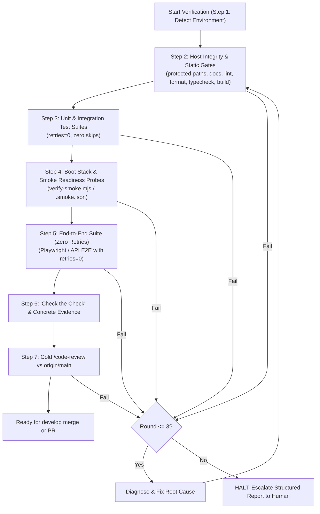

# Verify Skill

Enforce rigorous, evidence-based verification across any repository, inspired by Anthropic's *"How the Claude Code team thinks about verification"* and hardened with **Verification Brakes** so that automated or interactive runs can never pass a check by weakening the check itself.

---

## Purpose & Non-Negotiable Rules

1. **Verify Before Promotion**: Never open a Pull Request, request an integration merge into `develop`, or claim a feature/fix is ready without running the full verification pipeline on the exact `HEAD` commit.
2. **Default-Branch Review Immutability**: Verification and code reviews MUST read `REVIEW.md` and `CODING_STANDARDS.md` (when present) strictly from the remote default branch (`origin/main`). A working branch can never weaken its own evaluation criteria.
3. **Protected Verification Paths**: Any modification to test runner configs (`playwright.config.*`, `vitest.config.*`, `jest.config.*`), review/standards docs (`REVIEW.md`, `CODING_STANDARDS.md`, `AGENTS.md`), linter/typechecker configs (`eslint.config.*`, `.eslintrc*`, `tsconfig*.json`), CI/git hooks (`.github/**`, `.githooks/**`, `docker-compose.yml`, `**/Dockerfile*`), or core governance skills (`.agents/skills/{verify,code-review,testing,pr,git-branching,conventional-commits}/**`) is a **Protected Verification Path violation** (`HIGH RISK`) that blocks autonomous promotion and requires explicit human Code Owner sign-off.
4. **Zero Test Flakiness Workarounds**:
   - Never skip tests (`.skip`, `.only`, `.fixme`, `.todo`, `xit`, `xtest`, `@pytest.mark.skip`, etc.).
   - Never enable test retries (`retries: 0` in Playwright, Vitest, Jest, and Pytest).
   - Never add arbitrary sleeps (`waitForTimeout`, `setTimeout`, `time.sleep`) as flakiness band-aids. Use deterministic condition assertions (`toBeVisible`, `waitForResponse`, fake timers).
5. **Three-Round Fix Cap**: If any verification gate fails, diagnose the root cause and attempt fixes for up to **3 rounds**. If the failure persists after 3 rounds, **HALT immediately** and escalate structured diagnostics to the human maintainer.

---

## Verification Pipeline



---

## Step 1: Discover Verification Config & Execution Context

1. **Read Harness Config**: Check `docs/agents/verification.md` and `docs/agents/stack.md` (created by [`/setup-rblf-skills`](../setup-rblf-skills/SKILL.md)).
   - If `docs/agents/verification.md` does not exist yet, auto-detect from `docker-compose.yml`, `package.json`, `pyproject.toml`, `Makefile`, or `scripts/ci-gates.sh`.
2. **Detect Worktree & Container Context**:
   - Check if running inside a secondary git worktree (e.g., `.worktree.json` exists or `git rev-parse --git-common-dir` differs from `git rev-parse --git-dir`). If the repository provides a worktree service wrapper (such as `bun run wt`), route service commands through it instead of running bare `docker compose up` in a secondary worktree.
   - If the repository has a `docker-compose.yml` defining application services, execute all build, test, and gate commands inside Docker (`docker compose run --rm <service> ...`).

---

## Step 2: Run Host Integrity & Static Gates

Execute all repository self-tests, static analysis checks, and documentation checks configured in `docs/agents/verification.md` (or auto-detected):

1. **Verification Integrity & Self-Tests**:
   - Run the bundled smoke script's self-test to ensure probe logic is intact:
     ```bash
     node <path-to-verify-skill>/scripts/verify-smoke.mjs --self-test
     ```
   - If the repository includes custom integrity or architecture scripts (e.g., `scripts/check-verification-integrity.mjs`, `scripts/check-architecture.mjs`, `scripts/check-docs.py`), run their `--self-test` and main checks.
   - Scan the branch diff (`git diff origin/main...HEAD`) to verify that no `.skip`, `.only`, `.todo`, `retries > 0`, or `waitForTimeout` were introduced in test files, and check whether any **Protected Verification Paths** were modified.
2. **Static Gates (Format, Lint, Typecheck, Build)**:
   - Run formatter check, linter, typechecker, and build across all modified packages/services (e.g., `bash scripts/ci-gates.sh static`, `docker compose run --rm api bun run build`, `docker compose run --rm web bun run typecheck`, or host equivalents `pnpm lint && pnpm typecheck`, `ruff check . && mypy .`).

---

## Step 3: Run Unit & Integration Test Suites

Execute the unit and integration test suites for all affected layers with zero retries:

- **Dockerized Full-Stack Example**:
  ```bash
  docker compose run --rm api bun run test
  docker compose run --rm api bun run test:e2e
  ```
- **Host Node / Python Example**:
  ```bash
  pnpm test        # or bun test / vitest run --retry=0
  pytest           # with zero retry plugins
  ```

---

## Step 4: Boot Stack & Run Smoke Readiness Probes (`verify-smoke.mjs`)

Whenever the repository runs one or more HTTP or GraphQL services (API server, web app, background worker health endpoint), boot the stack and run the bundled [`scripts/verify-smoke.mjs`](scripts/verify-smoke.mjs) probe to prove the services actually start, wire up their dependency injection / database connections, and respond cleanly.

### Configuring `verify-smoke.mjs`

`verify-smoke.mjs` is zero-dependency Node ESM and resolves its probes in priority order:

1. **Explicit CLI flags**:
   ```bash
   node <path-to-verify-skill>/scripts/verify-smoke.mjs \
     --url http://localhost:3000/ \
     --url http://localhost:3000/login \
     --graphql-url http://localhost:3333/graphql \
     --csrf-header "x-requested-with:XmlHttpRequest" \
     --timeout 120000 \
     --interval 1800
   ```
2. **Repository `.smoke.json`** at the workspace root:
   ```json
   {
     "appName": "my-service",
     "timeoutMs": 120000,
     "pollIntervalMs": 1800,
     "probes": [
       { "name": "Web Root", "url": "http://localhost:3000/", "method": "GET", "expectStatus": [200, 302, 307] },
       { "name": "API GraphQL", "url": "http://localhost:3333/graphql", "type": "graphql", "csrfHeader": "x-requested-with:XmlHttpRequest" }
     ]
   }
   ```
3. **Auto-detection fallback** from `.worktree.json` and `.env` (`WEB_BASE_URL`, `API_BASE_URL`, `PORT`, `DEV_PORT`, `APP_NAME`).

Key probe protections:
- **Rate-limit friendly**: defaults to a 1.8s polling interval (`<= 34 req/min`) so strict API throttlers (e.g., 60 req/min) are never tripped during warmup.
- **CSRF validation**: supports custom CSRF headers on GraphQL POST introspection probes (`query HealthCheck { __typename }`).
- **Automatic failure diagnostics**: dumps recent `docker compose logs --tail=100` when a probe times out.

---

## Step 5: Run End-to-End Suite (Zero Retries)

If the repository includes browser or full-stack E2E tests (e.g., Playwright, Cypress, or API E2E suites), execute them against the live stack with **zero retries**:

```bash
# Dockerized Playwright example:
docker compose --profile e2e run --rm --no-deps -e CI=true e2e bun run test:e2e

# Host Playwright example:
CI=true npx playwright test --retries=0
```

If an E2E spec fails:
- Inspect trace/screenshot artifacts (`test-results/`, `playwright-report/`).
- Diagnose the root cause without adding timeouts, sleeps, or retries.

---

## Step 6: "Check the Check" & Concrete Evidence Collection

1. **"Check the Check"**: For every new or modified test in the diff, verify that the test actively fails when the corresponding feature logic or bug fix is inverted or commented out. Never trust a test that has not proven it can fail for the right reason.
2. **Concrete Evidence**: Record actual terminal outputs, exit codes, test counts, and smoke probe timings. Speculative claims like *"tests should pass"* or *"looks good by inspection"* violate this skill.

---

## Step 7: Cold Code Review Against `origin/main`

Before opening a PR or merging into `develop`, invoke [`/code-review`](../code-review/SKILL.md) against `origin/main` (or the repository's configured default branch):

```bash
git fetch origin main
# Load immutable review rules and coding standards from origin/main when present:
git show origin/main:REVIEW.md 2>/dev/null || true
git show origin/main:CODING_STANDARDS.md 2>/dev/null || true
```

Evaluate both axes in parallel sub-agents:
- **Standards Review**: Does `git diff origin/main...HEAD` conform to the architecture, conventions, and review rules on `origin/main` (plus the Fowler code smells baseline), without unauthorized edits to Protected Verification Paths?
- **Spec Review**: Does the diff satisfy every requirement of the originating ticket/spec without scope creep?

---

## Failure Recovery & Three-Round Fix Cap

When any step in the verification pipeline fails:

1. Increment the failure counter (`round = round + 1`).
2. **If `round > 3`**:
   - **STOP IMMEDIATELY**. Do not make a 4th automated edit attempt.
   - Present a structured escalation report to the human maintainer containing:
     - The exact failing command and terminal output.
     - Hypotheses tested and root causes uncovered across Rounds 1–3.
     - Concrete options requiring a maintainer decision.
3. **If `round <= 3`**:
   - Isolate the root cause (using tight feedback loops on the single failing test before re-running the full suite).
   - Apply a surgical fix without touching Protected Verification Paths or adding flakiness workarounds.
   - Re-run the verification pipeline from Step 2 to ensure no regressions were introduced.
